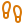
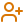
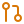

<!-- readme-standard: 2026-11-02 -->

# The Holy Earth Foundation: `.github`

*The organisation's profile and the community files every repository here inherits.*

 **You are here:** The Holy Earth Foundation › `.github` · public · `main` is the working branch

##  TL;DR

1.  **What this is.** The organisation's public profile, [`profile/README.md`](profile/README.md), and its community-health files.
2.  **Who it is for.** Anyone arriving at the foundation on GitHub, and anyone joining.
3.  **Do this first.** Joined the organisation? Start with [`ONBOARDING.md`](ONBOARDING.md). Otherwise see the [profile](https://github.com/theholyearthfoundation).

##  What is here

| | Path | What it is |
|---|---|---|
|  | [`profile/`](profile/) | The profile page and its banners. Its `README.md` is also mirrored to the portal, so its pictures use full addresses. |
|  | [`ONBOARDING.md`](ONBOARDING.md) | The welcome for a new member |
|  | [`CONTRIBUTING.md`](CONTRIBUTING.md) | How to contribute |
|  | [`SECURITY.md`](SECURITY.md) | The default security policy for any repository here without its own |
|  | [`decks/`](decks/) | The welcome deck |
|  | [`SOCIAL-PREVIEWS.md`](SOCIAL-PREVIEWS.md) | Refreshing the share cards of the foundation's Pages sites |
|  | [`TRADEMARKS.md`](TRADEMARKS.md), [`LICENSE`](LICENSE), [`LICENSE-CONTENT`](LICENSE-CONTENT) | The marks and the licences |

##  Suggest a change

Noticed something? Open an [issue](https://github.com/theholyearthfoundation/.github/issues) or a pull request against `main`; the foundation's stewards read them and a person with the role merges. Not on GitHub? Reach the foundation through [iamoneself.com](https://www.iamoneself.com).

The front door follows the living [README standard](https://github.com/drasticstatic/my-template/blob/main/README-STANDARD.md). Copy it, improve it.
